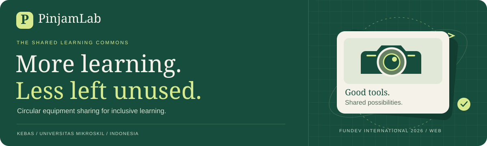
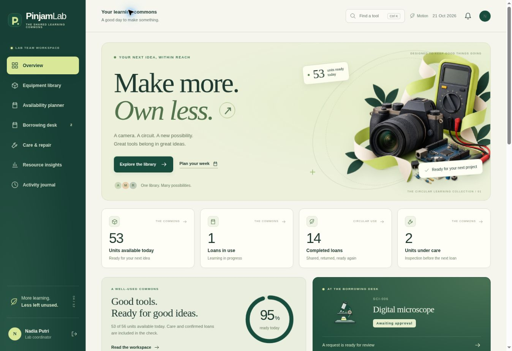
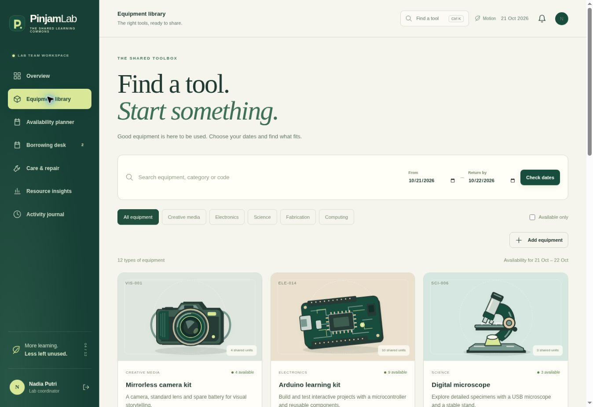
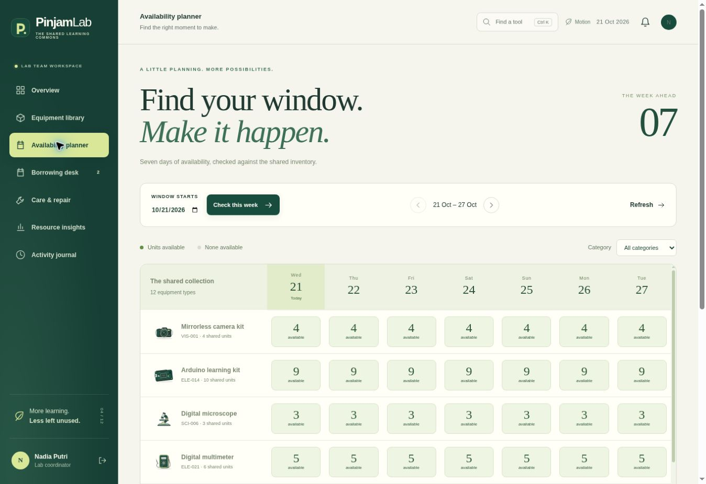
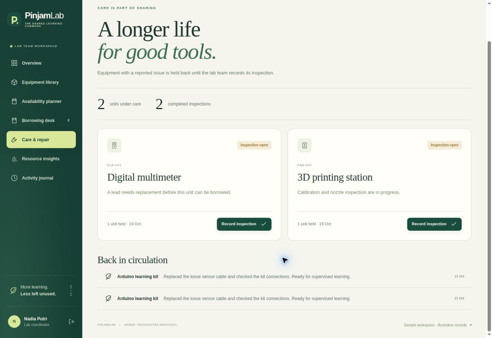

<p align="center"></p>

# PinjamLab

**Circular Equipment Sharing for Inclusive Learning**  
FunDev International Competition 2026 · Web Development  
**KEBAS (Keluarga Bebas)** · Universitas Mikroskil · Indonesia

[Watch the 3:30 English-captioned demo](https://drive.google.com/file/d/186kJ-KZZsEFrTM5ohyM9NTE-4W9wUyE7/view?pli=1) · [Run locally](#run-locally) · [Judge walkthrough](#judge-walkthrough) · [Verification](#verification) · [Judge evidence](docs/JUDGE_EVIDENCE.md) · [SDG evidence](#sdg-contribution-and-validation)

PinjamLab helps learners find shared equipment, plan a borrowing period and follow a request through its return. Laboratory staff can review access, confirm current capacity and keep equipment under care until an inspection is recorded. Discovery, allocation and condition stay connected to the same persistent records.

A laboratory can own useful tools while learners still struggle to know what is available or how to borrow it. A booking calendar also needs to account for equipment that has not actually returned or is waiting for repair. PinjamLab addresses that operational gap with a complete access-and-care workflow.

## The contribution

| Operational need | Implemented response | Why it matters |
|---|---|---|
| See when a suitable tool may be available | Searchable illustrated catalogue and seven-day server-calculated planner | Plan a learning period before submitting a request. |
| Explain the review order | Queue ordered by fewer completed loans in the previous 30 days, then request time | Staff and learners can inspect the rule; staff retains the decision. |
| Allocate the final available unit reliably | Capacity rechecked inside an immediate SQLite transaction at approval | Competing approvals cannot rely on the same stale browser count. |
| Keep an unsafe return out of circulation | Condition note, maintenance hold and recorded inspection release | Closing a loan and making equipment ready are separate decisions. |
| Explain what happened later | Loan journey, asset care history, staff journal and scoped export | Access and care remain traceable through the same workflow. |

The contribution is this connection between access and care. The project makes no claim to be the first equipment-lending application, and the queue is a review aid rather than a certified measure of fairness or disadvantage.

## Inside the workspace



<table>
<tr><td width="50%"><strong>Equipment library</strong><br></td><td width="50%"><strong>Weekly availability</strong><br></td></tr>
</table>

These are actual application captures from **21 October 2026**, using illustrative accounts, inventory and transactions. The final captured walkthrough shows 14 completed loans and two units under care. These counts are software state, not measured campus outcomes.

## Run locally

Use **Node.js 22.13 or newer**. Open the repository folder, or `01_application` in the full submission ZIP, and run:

```sh
npm start
```

Open **http://127.0.0.1:8080**. On Windows, double-click `MULAI_PINJAMLAB.cmd`. Keep the terminal open and stop the server with Ctrl+C. No `npm install`, Python, front-end build or separate database service is needed. After Node is installed, the local workflow runs without a CDN or internet connection.

The first run creates `data/pinjamlab.sqlite` with fictional sample records. Choose **As a learner** or **As the lab team** on the sign-in page, or use:

| Sample role | Email | Password |
|---|---|---|
| Learner — Ari Pratama | `learner@pinjamlab.local` | `LearnTogether!2026` |
| Lab coordinator — Nadia Putri | `lab@pinjamlab.local` | `CareForTools!2026` |

Changes persist in that local database. These published sample credentials belong to fictional demonstration accounts; a real deployment uses separately provisioned accounts and production mode.

## Judge walkthrough

Use a fresh sample workspace and **today through tomorrow**. Exact request numbers and counters depend on the workspace's existing activity.

| Step | Role and action | Observable result |
|---:|---|---|
| 1 | Learner: open **Availability planner**, filter Electronics and choose an available Arduino day. | The selected tool and start date open in the request form. |
| 2 | Request one kit with a learning purpose. | A pending request appears in **My borrowing**; it does not reserve stock. |
| 3 | Sign out and enter **As the lab team**. Open **Borrowing desk**. | Staff sees the review queue, its recent-loan reason and request details. |
| 4 | Review and approve the request. | The server checks current capacity and the journey advances to approved. |
| 5 | Record pickup during the valid borrowing dates. | The journey advances to collected; the kit remains unavailable until returned. |
| 6 | Record return as **Needs repair or inspection**, with a meaningful note. | The loan is returned and the affected unit enters a maintenance hold. |
| 7 | Open **Care & repair**, record the completed inspection and release the unit. | The hold is released once and the care record remains visible. |
| 8 | Inspect **Resource insights**, activity history and CSV export. | Summaries reflect stored records; a learner export contains that learner's records only. |

The included video uses illustrative record **PL-0018**: completed loans 13→14, held units 2→3→2 and completed inspections 1→2. Reproduce the actions rather than expecting a new database to start with that final state. The concurrent-approval constraint is demonstrated by the actual integration test; the video does not stage a fabricated browser rejection.

<details>
<summary><strong>See the inspection and recorded-release view</strong></summary>



The illustrated workspace retains the inspection note after the unit is released.

</details>

## Implemented features

| Learner workspace | Laboratory workspace |
|---|---|
| Registration, sign-in and own borrowing records | Role-protected requests, inventory and activity journal |
| Dated catalogue, categories and available-only filter | Explainable review queue and approval/rejection notes |
| Seven-day planner, category filter and week navigation | Transactional capacity checks at approval |
| Ctrl/Cmd K or / command search | Staff-recorded pickup, return and inspection |
| One-to-seven-day requests with quantity and purpose | Condition holds and one-time recorded release |
| Four-stage journey and permitted cancellation | Equipment care history, insights and scoped CSV export |
| Stored notifications and same-category alternatives | Add equipment with code, location, quantity and illustration |

The interface includes twelve native SVG equipment illustrations, page-entry and interaction motion, readiness summaries, keyboard focus and responsive navigation. **Motion** saves a local preference; operating-system reduced motion is always respected. **Escape** closes dialogs and the narrow navigation drawer. Available alternatives still require a suitability check for the learning task.

## Verification

```sh
npm run check
npm test
```

**Measured result: 40 tests passed, 0 failed, 0 skipped**, Node.js **v24.19.0**, verified on **21 October 2026**. [Read the complete output](docs/test-results.txt).

The tests launch real HTTP servers against separate temporary SQLite databases. They exercise behavior rather than relying on screenshots alone:

| Evidence area | Checked behavior | Source |
|---|---|---|
| Permissions and privacy | Anonymous access, learner/staff boundaries, cross-account records and scoped CSV | [application.test.mjs](tests/application.test.mjs) |
| Allocation and lifecycle | Parallel approvals, duplicate requests, pickup, return, condition holds and repeat-release rejection | [application.test.mjs](tests/application.test.mjs) |
| Weekly planner | Signed-in access, aggregate-only responses, daily count consistency and date/horizon validation | [application.test.mjs](tests/application.test.mjs) |
| Inventory arithmetic | Peak concurrent occupancy, adjacent dates, pending requests and checked-out inventory | [domain.test.mjs](tests/domain.test.mjs) |
| Operational setup | Production sample restrictions, staff bootstrap, backups and Jakarta date boundaries | [production.test.mjs](tests/production.test.mjs) |

Browser review completed the request-to-inspection workflow, command search, weekly navigation and category filtering. All twelve SVG equipment symbols rendered. Reducing and re-enabling motion kept all twelve catalogue cards visible. Responsive dashboard fixtures at 390px and 768px showed no global horizontal overflow after layout corrections. This is the scope of the recorded browser review, not exhaustive device certification.

The checked runtime is native Node. Docker configuration is included but was not built in the recorded environment. No independent security audit, completed user pilot or competition result is claimed.

## Availability rules

- Calendar dates use **Asia/Jakarta**. A loan covers `[borrow date, return date)`, so adjacent approved periods can meet at the return boundary.
- Requests last **one to seven days** and start within the **90-day booking horizon**. Pickup must occur before the return boundary.
- The planner displays seven daily counts and may start up to **84 days** ahead, keeping every displayed day inside the booking horizon. Each cell is one day's view; a longer request is checked across its complete period.
- The server computes peak concurrent approved occupancy rather than summing reservations that do not overlap. Maintenance quantities reduce capacity. Pending requests do not reserve equipment.
- Collected units remain unavailable, including for later dates, until an actual return is recorded. This conservative rule avoids promising equipment whose return is unconfirmed.
- Staff approval rechecks current capacity in a database transaction. Catalogue and planner counts help planning; they do not guarantee allocation.

### What an inventory record identifies

Each asset code identifies an **equipment type and stock quantity**. Loan and care events refer to that type; individual units have no separate serial identifier. A hold reduces the affected quantity and a resolution releases it once. A later loan of the same type does not by itself prove reuse of the exact repaired device. That measurement needs a pilot unit log or a validated serial-level extension.

## SDG contribution and validation

| Target | Application mechanism | Evidence available | Next measurement |
|---|---|---|---|
| **SDG 4.3** — access to technical and tertiary learning | Equipment discovery, planned requests and visible status | Working access workflow and persistent loan records | Request completion, suitable handovers and remaining access barriers |
| **SDG 12.2** — resource efficiency | Share existing stock and inspect dated availability | Inventory and recorded borrowing activity | Recorded use with an available-time denominator; procurement data for purchase claims |
| **SDG 12.5** — prevention and reuse | Condition return, inspection hold and recorded release | Traceable care quantities and events by equipment type | Later borrowing by type; a unit-identification log is needed to establish reuse of the exact device |

These are contribution pathways. A completed loan does not establish emissions avoided, and a maintenance record alone does not establish waste prevented.

A **planned supervised pilot** involves 6–10 students and 1–2 laboratory staff, with agreed consent and data handling. Equivalent tasks compare the current process with PinjamLab, alternating task order. Measures include request time, successful access, approval conflicts, return timeliness and later use after care. Report failures, assistance and staff exceptions. [Read the full pilot protocol and measurement definitions](docs/VALIDATION_AND_IMPACT.md).

## Portability and design tradeoffs

| Choice | Reason for the submitted scope | Adaptation before wider use |
|---|---|---|
| Browser interface and English presentation | Shared access without a separate phone app | Translate labels and test local terminology and accessibility needs. |
| Local date convention | One clear rule for the Indonesian sample | Review the institution's time zone and rerun boundary tests when changing it. |
| Explicit recent-borrowing rule | A review reason that people can inspect | Agree the policy locally, examine coursework exceptions and evaluate actual access outcomes. |
| One institution and SQLite | A small stack that can be run and inspected | Capacity-test concurrent writes and design tenancy boundaries before serving many institutions. |
| No payment or national-ID dependency | The core workflow can be adapted to other educational settings | Add institution-approved identity verification and eligibility procedures. |

SSO, email reminders, individual physical-unit serial numbers and external repair integration are future work. They are not presented as implemented features.

## Architecture

| Layer | Responsibility and boundary |
|---|---|
| Native HTML, CSS and JavaScript | Learner/staff pages, semantic controls, command search, planner and visual journey |
| Node.js HTTP routes | Authenticate sessions, check role/origin/CSRF, validate input and enforce transitions |
| SQLite transactions | Persist records and enforce current inventory at approval and care changes |
| Equipment and loan records | Keep allocation, condition, maintenance and audit history traceable |

The runtime uses built-in `http`, `crypto`, `fs` and `sqlite` modules. There are **zero npm dependencies**, with no external front-end scripts, web fonts or trackers.

| File | Responsibility |
|---|---|
| `server.mjs` | Routes, sessions, validation, permissions and state transitions |
| `db.mjs`, `schema.sql` | Password hashing, schema, sample setup and occupancy calculation |
| `public/app.js` | Browser rendering, controls and API calls |
| `public/style.css`, `public/experience.css` | Responsive layout, illustration surfaces and motion preferences |
| `public/assets/equipment-collection.svg` | Twelve purpose-made vector equipment illustrations |
| `manage.mjs` | Staff bootstrap, consistent backups and database integrity checks |
| `tests/` | Domain, application integration and production checks |

<details>
<summary><strong>API, security and production operations</strong></summary>

## API

| Route | Access | Action |
| --- | --- | --- |
| GET `/api/health` | Public | Process/database check |
| GET `/api/session` | Public | Session and CSRF token |
| POST `/api/auth/login`, `/register`, `/logout` | Session + CSRF | Authentication; registration creates learners only |
| POST `/api/auth/demo` | Sample + CSRF | Fictional learner/staff sign-in |
| GET `/api/bootstrap` | Signed in | Role-scoped workspace |
| GET `/api/availability?from=YYYY-MM-DD` | Signed in | Seven daily aggregate availability values per equipment type; no borrower records |
| GET `/api/assets`, `/api/assets/:id` | Signed in | Dated availability and care history |
| POST `/api/assets` | Staff | Add equipment |
| POST `/api/loans` | Learner | Request equipment |
| POST `/api/loans/:id/approve`, `/reject`, `/checkout`, `/return` | Staff | Enforced loan transitions |
| POST `/api/loans/:id/cancel` | Owner or staff | Cancel a pending/approved request |
| POST `/api/maintenance/:id/resolve` | Staff | Record inspection and release held units |
| POST `/api/notifications/read` | Signed in | Mark own updates read |
| GET `/api/events` | Staff | Audit journal |
| GET `/api/export.csv` | Signed in | Own loans, or all loans for staff |

Mutating calls require the active session's `X-CSRF-Token`. Sessions use HttpOnly, SameSite=Strict cookies, hashed random tokens, an eight-hour lifetime and token regeneration at sign-in. Passwords use salted scrypt. Prepared SQL, escaped UI text, restrictive Content Security Policy and CSV formula-prefix protection are included. Sign-in attempts are limited per address/email within the running process.

## Production configuration

| Variable | Default | Purpose |
| --- | --- | --- |
| `HOST` | 127.0.0.1 | Listening interface |
| `PORT` | 8080 | HTTP port |
| `PINJAMLAB_DB` | data/pinjamlab.sqlite | Persistent database path |
| `PINJAMLAB_MODE` | sample | Set `production` to disable sample sign-in/seeding |
| `PINJAMLAB_COOKIE_SECURE` | 0 | Set `1` with HTTPS |
| `PINJAMLAB_ALLOWED_ORIGIN` | unset | Exact origin if a reverse proxy changes the host header |

Use a **new database file** for real use. Production mode does not erase accounts from an existing sample database. Create the first staff account locally with a password supplied through the environment:

```sh
export PINJAMLAB_DB=/absolute/private/path/pinjamlab-production.sqlite
read -rs -p 'New staff password: ' PINJAMLAB_ADMIN_PASSWORD; echo
export PINJAMLAB_ADMIN_PASSWORD
node manage.mjs create-staff --email lab@example.edu --name 'Lab Coordinator'
unset PINJAMLAB_ADMIN_PASSWORD
PINJAMLAB_MODE=production npm start
```

Use at least 12 password characters. In Windows PowerShell, set the equivalent `$env:PINJAMLAB_DB` and `$env:PINJAMLAB_ADMIN_PASSWORD`, run the command, then remove the password variable. Learners register through the interface; staff add equipment through **Add equipment**. Use TLS and persistent storage for a public deployment.

Optional Docker configuration:

```sh
docker compose up --build
```

Compose defaults to local-only exposure, sample mode and a persistent volume. Native Node execution is the verified run path; Docker depends on the host.

Create a consistent database backup and check its live integrity:

```sh
node manage.mjs backup --out backups/pinjamlab-backup.sqlite
node manage.mjs check
```

Restore only after stopping the app, keeping the existing database safely and replacing it with a verified backup. Database files and backups must remain private.


</details>

## How the submission addresses the rubric

[Open the judge evidence map](docs/JUDGE_EVIDENCE.md) for exact source links, test names, video chapters and slide references for each criterion.


| Official criterion | Weight | Concrete evidence in this project |
|---|---:|---|
| Innovation & Creativity | 25% | Connected planning, explainable access review, transactional allocation and care before reuse |
| Functionality & Technical Quality | 25% | Runnable application, enforced server rules, persistent records and 40 passing tests |
| Impact & Relevance | 20% | SDG 4/12 pathways, defined pilot measures and an explicit portability plan |
| Video & Documentation Quality | 15% | 1080p English-captioned demo, English poster, this README and traceable verification |
| Presentation & Q&A | 15% | Fourteen-slide English deck, ten-minute pitch notes and technical/impact explanation practice in the full package |

Weights were checked against the [official judging criteria](https://fundev.vokasi-usu.id/judging-criteria) on **22 October 2026**. The preliminary round uses the first four criteria; the final uses all five. This is an evidence map, not a predicted score.

## Team and attribution

Prepared for **KEBAS (Keluarga Bebas)**: Fikri Anwar, Dafa Aditya Nazwan Priyadi and Jordani Brema Barus, **Universitas Mikroskil, Indonesia**.

Code, tests, documentation and presentation preparation used **OpenAI Codex assistance**. The hero equipment illustration used OpenAI image generation; native SVG artwork and editorial layouts were purpose-made for the project. Illustrations do not represent actual university inventory. The team is responsible for reviewing, understanding and presenting the submitted work and accurately completing its originality declaration.

Project context included earlier Flask coursework attributed to **Tim Coko**. The submitted application is a separately produced Node implementation; the reference authorship has not been relabelled. The earlier Flask source is not included in this repository.

Node.js and SQLite retain their upstream licenses. DejaVu fonts and their license, plus the official statement's embedded-font license, are included with the full submission package. Student ID images, private participant contacts, signed statements, database files and backups are excluded from this public source repository.

## Official sources

- [Submission requirements](https://fundev.vokasi-usu.id/submission-guide)
- [Judging criteria](https://fundev.vokasi-usu.id/judging-criteria)
- [Competition rules](https://fundev.vokasi-usu.id/rules)
- [Final presentation requirements](https://fundev.vokasi-usu.id/final-presentation)
- [UN SDG 4](https://sdgs.un.org/goals/goal4) and [UN SDG 12](https://sdgs.un.org/goals/goal12)

Repository: **https://github.com/fikriianwarr/pinjamlab-fundev-2026** · branch **main** · application **2.0.0** · documentation reviewed **22 October 2026**.
