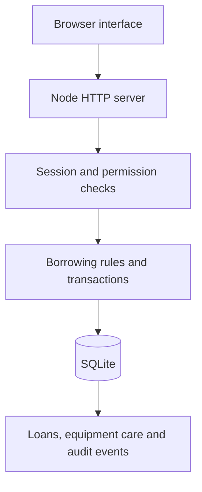

# PinjamLab

**Circular Equipment Sharing for Inclusive Learning**  
FunDev International Competition 2026 · KEBAS (Keluarga Bebas) · Universitas Mikroskil, Indonesia

PinjamLab connects learning access with the care of shared equipment. Students discover tools and request borrowing dates; laboratory staff review access, confirm availability, record handovers and hold damaged equipment until an inspection is recorded.


## Run locally

Install **Node.js 22.13 or newer**, then run this command in the application folder:

```sh
npm start
```

Open **http://127.0.0.1:8080**. On Windows, double-click `MULAI_PINJAMLAB.cmd`. Keep the terminal open and stop the server with Ctrl+C. No npm package installation, Python or separate database service is required. After Node is installed, the local workflow runs offline.

The first run creates `data/pinjamlab.sqlite` with fictional equipment and borrowing records. Use **As a learner** or **As the lab team** on the sign-in page. Changes persist in that workspace.

| Sample role | Email | Password |
| --- | --- | --- |
| Learner — Ari Pratama | learner@pinjamlab.local | LearnTogether!2026 |
| Lab coordinator — Nadia Putri | lab@pinjamlab.local | CareForTools!2026 |

These are fictional demonstration accounts, unrelated to the team's real identities. Sample mode is intended for local judging and walkthroughs.

## Features

- Date-specific inventory search, categories and available-only filtering.
- Learner registration and sign-in; personal borrowing records and request cancellation.
- One-to-seven-day requests with quantities, learning purpose and duplicate detection.
- Staff review ordered by fewer completed loans in the previous 30 days, then request time. Staff makes the final decision; the order is a transparent review aid.
- Availability rechecked inside an immediate SQLite transaction at approval. Pending requests do not reserve inventory.
- Staff-only pickup, return and inspection recording with enforced loan state transitions.
- Damaged or unsafe returns create a maintenance hold with a required note. A recorded inspection releases held units.
- Available alternatives in the same category, without assuming technical interchangeability.
- Persistent notifications, asset care history, staff activity journal and scoped CSV export.
- Actual database summaries for availability, completed loans, confirmed learner access and on-time returns.
- Staff inventory creation with description, category, location, quantity and equipment symbol.
- Responsive layouts, keyboard focus, semantic controls and reduced-motion support.

## Demonstrate the complete workflow

1. Enter the learner sample workspace, open **Equipment library**, then **Arduino learning kit**.
2. Use today through tomorrow, one unit and a learning purpose. Select **Request equipment**.
3. Sign out through the account control and enter **As the lab team**.
4. Open **Borrowing desk**, review the request, approve it, then record pickup in its details.
5. Open that loan and record return. Choose **Needs repair or inspection** and describe the issue.
6. Open **Care & repair**. The unit stays unavailable until a completed inspection is recorded.
7. Check **Equipment care history**, **Resource insights**, notifications and the activity journal. Export CSV from the borrowing desk.

Only collect a loan during its valid dates. Repeated returns and repeated maintenance releases are rejected.

## Availability and dates

Calendar dates follow **Asia/Jakarta**. Loan periods use `[borrow date, return date)`; the return date is the boundary at which another approved booking can begin. Requests last one to seven days and start within the next 90 days. Pickup must occur before the return boundary.

For every requested day, the server counts concurrent approved quantities and checked-out quantities, then uses the maximum occupancy across the range. Maintenance quantities are subtracted. Non-overlapping bookings are not incorrectly added together. Checked-out units remain unavailable, including for future dates, until an actual return is recorded. This conservative rule avoids promising equipment whose return is unconfirmed.

On-time returns compare the recorded Jakarta return date with the agreed return date. Environmental savings are not inferred from this metric.

## Verification

```sh
npm run check
npm test
node manage.mjs check
```

**37 automated tests pass** on Node 24.19.0 in the packaged verification run. The suite launches real HTTP servers against separate temporary SQLite databases. It checks CSRF/origin enforcement, role permissions, cross-account restrictions, competing parallel approvals, booking boundaries, maintenance holds, repeat transitions, notification persistence, scoped exports, production bootstrap and consistent backups. It also covers the Jakarta/UTC return-date boundary. Temporary test databases are removed after the run. See `docs/test-results.txt` for the full measured output.

Browser verification and its scope are recorded separately in the packaged QA report. A passing test suite does not establish that every device or deployment environment has been tested.

## Architecture



Native HTML, CSS and JavaScript provide the frontend. The server uses Node's built-in `http`, `crypto`, `fs` and `sqlite` modules. There are **zero npm dependencies** and no external frontend scripts, fonts, trackers or APIs.

| File | Responsibility |
| --- | --- |
| `server.mjs` | HTTP routes, validation, sessions, permissions and loan transitions |
| `db.mjs` | Schema setup, scrypt passwords, sample records and peak occupancy |
| `schema.sql` | Constraints, foreign keys and persistent tables |
| `public/app.js` | Browser interface and API calls |
| `public/style.css` | Responsive visual system and motion preferences |
| `manage.mjs` | Local staff bootstrap, backups and integrity checks |
| `tests/` | Domain, integration and production checks |

## API

| Route | Access | Action |
| --- | --- | --- |
| GET `/api/health` | Public | Process/database check |
| GET `/api/session` | Public | Session and CSRF token |
| POST `/api/auth/login`, `/register`, `/logout` | Session + CSRF | Authentication; registration creates learners only |
| POST `/api/auth/demo` | Sample + CSRF | Fictional learner/staff sign-in |
| GET `/api/bootstrap` | Signed in | Role-scoped workspace |
| GET `/api/assets`, `/api/assets/:id` | Signed in | Dated availability and care history |
| POST `/api/assets` | Staff | Add equipment |
| POST `/api/loans` | Learner | Request equipment |
| POST `/api/loans/:id/approve`, `/reject`, `/checkout`, `/return` | Staff | Enforced loan transitions |
| POST `/api/loans/:id/cancel` | Owner or staff | Cancel a pending/approved request |
| POST `/api/maintenance/:id/resolve` | Staff | Record inspection and release held units |
| POST `/api/notifications/read` | Signed in | Mark own updates read |
| GET `/api/events` | Staff | Audit journal |
| GET `/api/export.csv` | Signed in | Own loans, or all loans for staff |

Mutating calls require the active session's `X-CSRF-Token`. Sessions use HttpOnly, SameSite=Strict cookies, hashed random tokens, an eight-hour lifetime and token regeneration at sign-in. Passwords use salted scrypt. Prepared SQL, escaped UI text, restrictive Content Security Policy and CSV formula-prefix protection are included. Sign-in attempts are limited per address/email within the running process.

## Production configuration

| Variable | Default | Purpose |
| --- | --- | --- |
| `HOST` | 127.0.0.1 | Listening interface |
| `PORT` | 8080 | HTTP port |
| `PINJAMLAB_DB` | data/pinjamlab.sqlite | Persistent database path |
| `PINJAMLAB_MODE` | sample | Set `production` to disable sample sign-in/seeding |
| `PINJAMLAB_COOKIE_SECURE` | 0 | Set `1` with HTTPS |
| `PINJAMLAB_ALLOWED_ORIGIN` | unset | Exact origin if a reverse proxy changes the host header |

Use a **new database file** for real use. Production mode does not erase accounts from an existing sample database. Create the first staff account locally with a password supplied through the environment:

```sh
export PINJAMLAB_DB=/absolute/private/path/pinjamlab-production.sqlite
read -rs -p 'New staff password: ' PINJAMLAB_ADMIN_PASSWORD; echo
export PINJAMLAB_ADMIN_PASSWORD
node manage.mjs create-staff --email lab@example.edu --name 'Lab Coordinator'
unset PINJAMLAB_ADMIN_PASSWORD
PINJAMLAB_MODE=production npm start
```

Use at least 12 password characters. In Windows PowerShell, set the equivalent `$env:PINJAMLAB_DB` and `$env:PINJAMLAB_ADMIN_PASSWORD`, run the command, then remove the password variable. Learners register through the interface; staff add equipment through **Add equipment**. Use TLS and persistent storage for a public deployment.

Optional Docker configuration:

```sh
docker compose up --build
```

Compose defaults to local-only exposure, sample mode and a persistent volume. Native Node execution is the verified run path; Docker depends on the host.

Create a consistent database backup and check its live integrity:

```sh
node manage.mjs backup --out backups/pinjamlab-2026-10-21.sqlite
node manage.mjs check
```

Restore only after stopping the app, keeping the existing database safely and replacing it with a verified backup. Database files and backups must remain private.

## SDGs and validation

SDG 4 is addressed through equipment discovery, recorded learning access and a review aid for less-recent borrowers. SDG 12 is addressed through sharing, condition tracking and repair before reuse. These are contribution pathways, not measured causal outcomes.

Sample records illustrate the software. No university pilot, surveyed demand, emissions savings, cost savings or competition result is claimed. The full package includes a proposed supervised pilot with measurement definitions. Institutional identity checks, student eligibility, retention policies and user testing require validation before rollout. SSO, email reminders, individual serial numbers and external repair integration are future work.

## Team and attribution

Prepared for **KEBAS (Keluarga Bebas)** — Fikri Anwar, Dafa Aditya Nazwan Priyadi and Jordani Brema Barus, Universitas Mikroskil, Indonesia.

Source, tests, documentation and presentation preparation used **OpenAI Codex assistance**. The equipment illustration used OpenAI image generation and represents no actual university inventory. The team must review and take responsibility for the final submission and accurately credit tools in the official originality declaration.

The earlier Flask coursework supplied as reference remains attributed to Tim Coko. This is an independently generated Node implementation; no Flask source or coursework author list is relabelled as KEBAS's code. The supplied project name/concept was task context. The team must verify any broader ownership assertions before signing the declaration.

The mark and native icon paths were made for this submission. Node.js and SQLite retain their upstream licenses. The presentation's DejaVu fonts and license are included in the full package. Official FunDev requirements and UN SDG sources are cited in the documentation. Private student ID images and signature material are excluded from the public source branch.

Repository: https://github.com/fikriianwarr/pinjamlab-fundev-2026 · default branch: **main**.
